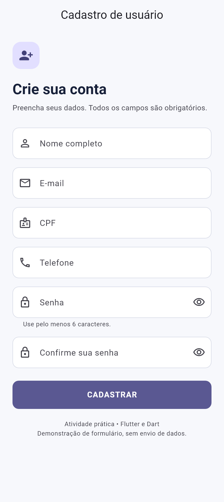
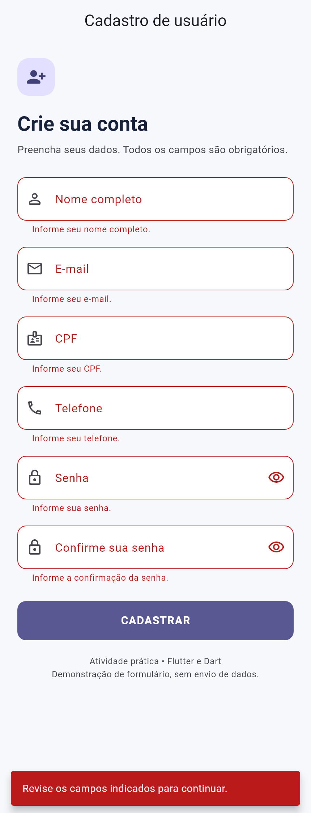
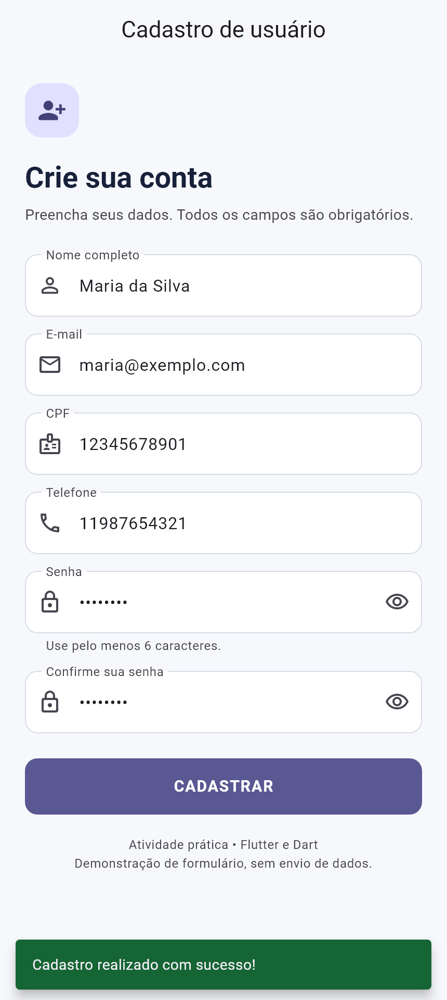

# Cadastro de usuário em Flutter

Atividade prática da disciplina **Desenvolvimento Mobile (Flutter e Dart)**, sobre formulários e validações. O aplicativo contém uma tela de cadastro com todos os requisitos obrigatórios e os quatro desafios extras.

## Telas

<p>
  
  
  
</p>

Capturas renderizadas a partir dos widgets do aplicativo, com dados fictícios.

## Requisitos implementados

| Campo | Teclado e entrada | Validação |
| --- | --- | --- |
| Nome completo | `TextInputType.name`, capitalização por palavra | Obrigatório; aceita texto livre |
| E-mail | `TextInputType.emailAddress` | Obrigatório; RegExp exige `@`, domínio com extensão e ausência de espaços internos |
| CPF | `TextInputType.number`, `FilteringTextInputFormatter.digitsOnly` | Obrigatório; somente dígitos |
| Telefone | `TextInputType.phone`, `FilteringTextInputFormatter.digitsOnly` | Obrigatório; somente dígitos |
| Senha | `TextInputType.visiblePassword`, texto oculto inicialmente | Obrigatória; mínimo de 6 caracteres |
| Confirmação de senha | Teclado de senha, texto oculto inicialmente | Obrigatória; deve ser idêntica à senha |

- O botão **CADASTRAR** chama `_formKey.currentState!.validate()`.
- Cada `validator` retorna a mensagem exibida abaixo do campo ou `null` quando válido.
- Campos vazios ou preenchidos apenas com espaços são inválidos.
- CPF e telefone filtram letras, espaços e pontuação também ao colar texto.
- Há `SizedBox(height: 16)` entre os campos e margens no formulário.
- `SingleChildScrollView` permite rolagem quando o teclado reduz a área disponível.
- A largura do conteúdo se adapta à tela, até 480 px.
- Os valores digitados são capturados por `TextEditingController`, liberados em `dispose()`.
- Após a primeira tentativa, os erros se atualizam durante a correção dos campos.
- O botão de ação do teclado no último campo também valida o formulário.

**Desafios extras:** confirmação de senha; botões independentes para mostrar/ocultar as duas senhas; e-mail com RegExp; SnackBar vermelho na tentativa inválida e verde quando todos os campos estão válidos.

O projeto demonstra o formulário e seu feedback visual. Os dados permanecem em memória durante o uso; não há backend, criação de conta remota, armazenamento ou envio de dados. O sucesso indica que a validação foi concluída. Conforme o enunciado, CPF e telefone não exigem tamanho específico nem verificação de dígitos verificadores.

## Hierarquia obrigatória

A estrutura abaixo está presente diretamente em `lib/tela_cadastro.dart`:

```text
Scaffold
└── Form(key: _formKey)
    └── SingleChildScrollView (com padding)
        └── Column
            ├── Cabeçalho
            ├── TextFormField (nome)
            ├── SizedBox(height: 16)
            ├── TextFormField (e-mail)
            ├── SizedBox(height: 16)
            ├── TextFormField (CPF)
            ├── SizedBox(height: 16)
            ├── TextFormField (telefone)
            ├── SizedBox(height: 16)
            ├── TextFormField (senha)
            ├── SizedBox(height: 16)
            ├── TextFormField (confirmação de senha)
            └── ElevatedButton (CADASTRAR)
```

## Executar

Ambiente usado na validação: **Flutter 3.47.1 stable e Dart 3.13.1**. Instale o Flutter e adicione `flutter/bin` ao PATH. O projeto possui estruturas para Android, iOS e web.

```bash
git clone https://github.com/vitoradriao/cadastro-usuario-flutter.git
cd cadastro-usuario-flutter
flutter pub get
flutter devices
flutter run
```

Para executar diretamente no navegador:

```bash
flutter run -d chrome
```

Para Android, configure o Android SDK e conecte um aparelho ou inicie um emulador. Para iOS, utilize macOS com Xcode. Se o comando `flutter` não for reconhecido, use o caminho completo do executável da sua instalação.

## Verificação

```bash
dart format --output=none --set-exit-if-changed lib test
flutter analyze
flutter test
flutter build web
```

A suíte contém **12 testes**, abrangendo obrigatoriedade, limites da senha, e-mail, conteúdo numérico, hierarquia de widgets, filtros de entrada, mensagens por campo, cores de erro, fluxo de sucesso, correção dos dados, dependência entre senhas, controles de visibilidade e tela de 320 × 568 com espaço reservado para o teclado.

O workflow `.github/workflows/flutter.yml` executa formatação, análise, testes e compilação web a cada push e pull request. A compilação nativa para Android/iOS não faz parte desse workflow.

Para conferir manualmente:

1. Pressione **CADASTRAR** com o formulário vazio e confira os seis erros e o SnackBar vermelho.
2. Cole `123.456.789-01abc` no CPF e confirme que restam apenas os números.
3. Informe um e-mail sem `@`, uma senha de cinco caracteres e uma confirmação diferente; confira os erros correspondentes.
4. Corrija o e-mail, use uma senha com pelo menos seis caracteres e repita-a na confirmação.
5. Alterne a visibilidade das senhas e pressione **CADASTRAR**; confira o SnackBar de sucesso.

## Organização

```text
lib/
  main.dart                 # Inicialização e tema Material 3
  tela_cadastro.dart         # Form, campos, controllers e SnackBars
  validadores.dart          # Regras de validação
test/
  validadores_test.dart     # Regras de cada campo
  tela_cadastro_test.dart   # Interações e comportamento da tela
docs/                       # Capturas da interface
android/                    # Projeto Android
ios/                        # Projeto iOS
web/                        # Projeto web
```

## Referências

- [Flutter: formulário com validação](https://docs.flutter.dev/cookbook/forms/validation)
- [Flutter: TextFormField](https://api.flutter.dev/flutter/material/TextFormField-class.html)
- [Flutter: FilteringTextInputFormatter.digitsOnly](https://api.flutter.dev/flutter/services/FilteringTextInputFormatter/digitsOnly.html)
